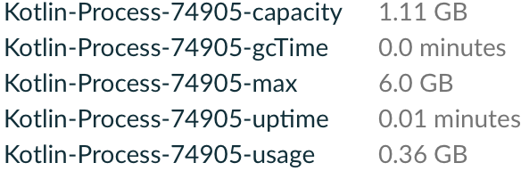

# Info Kotlin Process Plugin
Includes information about Kotlin processes in the Build Scans or in the build output.
The plugin is compatible with configuration cache.

## Usage
Apply the plugin in `settings.gradle(.kts)` so it observes the whole build, including all projects:

#### Kotlin (`settings.gradle.kts`)
Using the plugins DSL:
```kotlin
plugins {
  id("io.github.cdsap.kotlinprocess") version "0.3.0"
}
```

#### Groovy (`settings.gradle`)
Using the plugins DSL:
```groovy
plugins {
  id "io.github.cdsap.kotlinprocess" version "0.3.0"
}
```

The legacy project-plugin application in `build.gradle(.kts)` remains supported for
published consumers, but settings-plugin application is preferred for multi-project builds.

#### Legacy project application (`build.gradle.kts`)
```kotlin
plugins {
  id("io.github.cdsap.kotlinprocess") version "0.3.0"
}
```

Using legacy plugin application:
```kotlin
buildscript {
  repositories {
    gradlePluginPortal()
  }
  dependencies {
    classpath("io.github.cdsap:infokotlinprocess:0.3.0")
  }
}

apply(plugin = "io.github.cdsap.kotlinprocess")
```

#### Legacy project application (`build.gradle`)
```groovy
plugins {
  id "io.github.cdsap.kotlinprocess" version "0.3.0"
}
```

Using legacy plugin application:
```groovy
buildscript {
  repositories {
    gradlePluginPortal()
  }
  dependencies {
    classpath "io.github.cdsap:infokotlinprocess:0.3.0"
  }
}

apply plugin: "io.github.cdsap.kotlinprocess"
```

## Output
### Build Scans
If you are using Develocity, the information about the Kotlin processes will be included as custom value in the
Build Scan:



The field `Usage` represents the value obtained at the end of the build using `jstat` on the JVM process.

#### GBOS observations

GBOS file sinks and the GBOS Develocity projection are independent opt-in sinks. Enable
the file formats with Gradle properties:

```properties
infoKotlinProcess.gbos.json.enabled=true
infoKotlinProcess.gbos.ndjson.enabled=true
```

or configure it in the settings script:

```kotlin
infoKotlinProcess {
    gbos {
        json.set(true)
        ndjson.set(true)
        develocity.set(true)
    }
    legacy {
        enabled.set(false)
    }
}
```

The equivalent properties are:

```properties
infoKotlinProcess.gbos.develocity.enabled=true
infoKotlinProcess.legacy.enabled=true
```

Develocity is detected automatically. Its custom-value matrix is:

| Develocity | GBOS Develocity | Legacy output | Custom values |
| --- | --- | --- | --- |
| absent | any | any | no custom values; selected JSON/NDJSON files are still written |
| present | off | on | legacy `Kotlin-Process-*` values |
| present | on | off | only `gbos.*` values |
| present | on | on | `gbos.*` and legacy `Kotlin-Process-*` values |
| present | off | off | no custom values |

The table applies independently to all four JSON/NDJSON sink combinations: neither,
JSON only, NDJSON only, and both. Those flags select local files and do not change the
Develocity column.

`infoKotlinProcess.gbos.json.enabled` and `infoKotlinProcess.gbos.ndjson.enabled` only
control their respective local files; they do not enable the Develocity projection.
Legacy Develocity values are enabled by default for compatibility and can be disabled with
`infoKotlinProcess.legacy.enabled=false`. Each Kotlin daemon is reported as a `jvm.process`
entity observation.

The JSON and NDJSON files are written atomically to `${rootDir}/build/info-kotlin-process/gbos.json`
and `${rootDir}/build/info-kotlin-process/gbos.ndjson`. Each build replaces the selected file with
the observations generated by that build.

### Build Output
If you are not using Develocity, the information about the Kotlin processes will be included at the end of the build:
```
> Task :core:ui:compileProdDebugKotlin
┌─────────────────────────────────────────────────────────────────────────────┐
│  Kotlin processes                                                           │
├─────────┬──────────┬───────────┬────────────┬───────────────┬───────────────┤
│  PID    │  Max     │  Usage    │  Capacity  │  GC Time      │  Uptime       │
├─────────┼──────────┼───────────┼────────────┼───────────────┼───────────────┤
│  10865  │  1.0 Gb  │  0.66 Gb  │  1.0 Gb    │  0.0 minutes  │  0.0 minutes  │
├─────────┼──────────┼───────────┼────────────┼───────────────┼───────────────┤
│  9011   │  0.5 Gb  │  0.2 Gb   │  0.5 Gb    │  0.0 minutes  │  0.0 minutes  │
└─────────┴──────────┴───────────┴────────────┴───────────────┴───────────────┘
BUILD SUCCESSFUL in 35s

```


## Requirements
* Gradle 7.5

## Libraries
* `com.gradle:develocity-gradle-plugin`
* `com.jakewharton.picnic:picnic`
